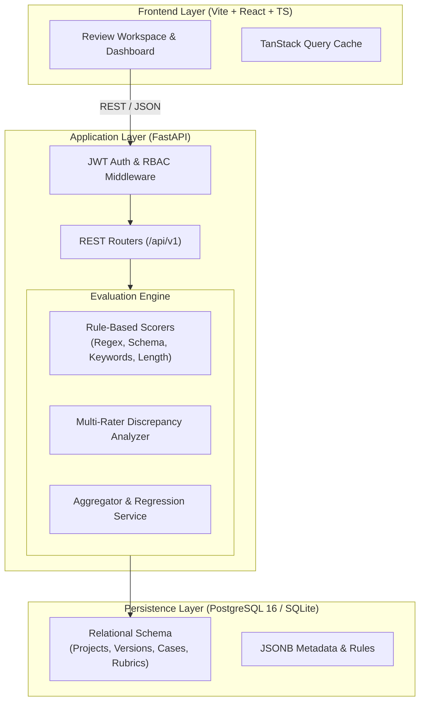

# EvalForge — AI Model Evaluation & Benchmarking Platform

[](https://github.com/otengedward882-cmd/evalforge-ai-evaluation-platform/actions)
[](https://python.org)
[](https://fastapi.tiangolo.com)
[](https://www.postgresql.org)
[](https://react.dev)
[](https://www.typescriptlang.org)
[](https://www.docker.com)
[](LICENSE)

EvalForge is a production-oriented AI evaluation and benchmarking platform engineered to test, score, validate, and compare Large Language Model (LLM) responses. It bridges automated deterministic assertions (regex, JSON schema enforcement, canary token checks) with calibrated human-in-the-loop scoring (Likert scales, double-blind reviews, and multi-rater adjudication).

---

## 📌 Problem Statement

Evaluating generative AI models in software workflows presents acute operational challenges:
1. **Non-Deterministic Degradation:** Model updates, quantization, or system prompt modifications can inadvertently cause regressions in instruction adherence and safety boundaries.
2. **Disconnected Evaluation Silos:** Automated programmatic tests and qualitative human review rubrics frequently live in incompatible systems without unified audit trails.
3. **Auditability & Provenance:** Teams lack immutable dataset versioning linked directly to quantitative pass rates, inter-annotator agreement metrics, and failure categorization.

EvalForge provides a unified, containerized platform enabling AI engineers, evaluators, and QA leads to ingest datasets, execute rule suites, resolve reviewer scoring discrepancies, and generate audit-ready regression reports.

---

## 👥 Target Users

* **AI Evaluation Specialists & Annotators:** Review candidate model outputs, score adherence against detailed rubrics, and document failure evidence.
* **LLM & Systems Engineers:** Automate CI/CD regression suites verifying schema contracts, token lengths, and canary token retention before model deployments.
* **Technical Quality Leads & Auditors:** Review multi-evaluator score variance, adjudicate disputed cases, and export audit trails.

---

## 🏗️ System Architecture



---

## ⚡ Main Features

* **Multi-Format Dataset Ingestion:** Stream-parse CSV and JSONL datasets with schema validation, malformed record detection, and immutable versioning.
* **Deterministic Evaluation Engine:** Automated rules verifying exact matches, required keywords, forbidden canary tokens, regex patterns, and JSON schema conformity.
* **Configurable Rubric Builder:** Declarative rubrics supporting binary, Likert (1-5), and continuous scales with criterion guidelines and anchor examples.
* **Double-Blind Human Review Queue:** Side-by-side evaluation workspace displaying prompts, candidate outputs, reference answers, and criteria.
* **Reviewer Discrepancy Adjudication:** Flags cases where independent evaluators diverge beyond variance thresholds for lead resolution.
* **Audit-Ready Export & Benchmarks:** Comprehensive score matrices exportable to CSV and structured JSON.

---

## 🛠️ Technology Stack

* **Backend:** Python 3.11+, FastAPI, Pydantic v2, SQLAlchemy 2.0, Alembic, Uvicorn
* **Database:** PostgreSQL 16 (production), SQLite (in-memory/local development fallback)
* **Frontend:** React 18, TypeScript, Vite, Tailwind CSS, TanStack Query, Lucide Icons
* **DevOps & Testing:** Docker, Docker Compose, pytest, pytest-asyncio, Ruff, GitHub Actions

---

## 🚀 Quickstart & Installation

### Option 1: Local Development Setup

#### Prerequisites
* Python 3.11+
* Git

```bash
# 1. Clone the repository
git clone https://github.com/otengedward882-cmd/evalforge-ai-evaluation-platform.git
cd evalforge-ai-evaluation-platform

# 2. Set up virtual environment
python -m venv venv
# On Windows:
.\venv\Scripts\activate
# On Linux/macOS:
source venv/bin/activate

# 3. Install backend dependencies
pip install -r backend/requirements.txt

# 4. Copy environment configuration
cp .env.example .env

# 5. Run the FastAPI development server
cd backend
python -m uvicorn app.main:app --reload --host 0.0.0.0 --port 8000
```

Once started:
* **Interactive Dashboard & API Documentation:** [http://localhost:8000/api/v1/docs](http://localhost:8000/api/v1/docs)
* **Health & Telemetry Endpoint:** [http://localhost:8000/api/v1/health](http://localhost:8000/api/v1/health)

---

### Option 2: Docker Compose Setup

```bash
# Build and start all services (PostgreSQL, Backend API, Frontend SPA)
docker compose up --build -d

# Check service logs
docker compose logs -f backend
```

---

## 🧪 Testing & Quality Assurance

Run the automated test suite with pytest:

```bash
# Execute unit and integration tests
python -m pytest tests -v

# Run with coverage report
python -m pytest tests --cov=backend/app --cov-report=term-missing
```

---

## 🔒 Security Architecture

* **Input Sanitization:** All payload structures validated via Pydantic schemas; zero raw string SQL interpolation.
* **Authentication:** Stateless JWT bearer tokens signed via HS256 with expiration and role verification.
* **Credential Isolation:** Strict separation of environment configurations; no secret keys committed to version control.

---

## 📄 License

This project is open-source and licensed under the [MIT License](LICENSE).
