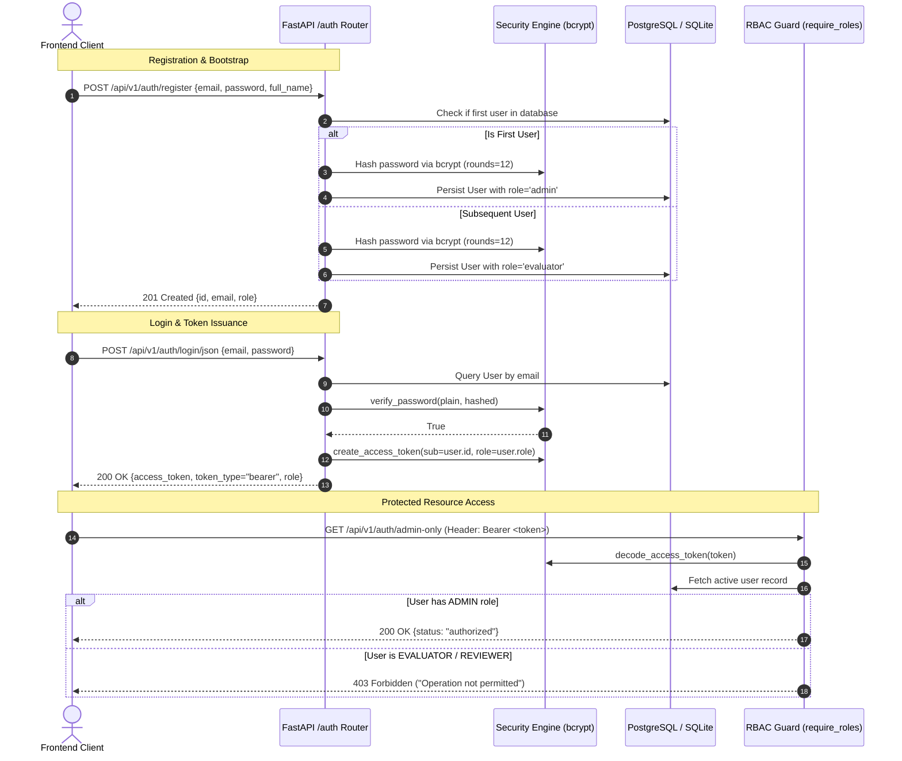

# Authentication & Role-Based Access Control (RBAC)

EvalForge implements a stateless JSON Web Token (JWT) authentication architecture using cryptographic signatures and strict Role-Based Access Control (RBAC).

---

## 1. Authentication Lifecycle

---

## 2. Supported User Roles

| Role | Scope | Permitted Actions |
| :--- | :---: | :--- |
| **`ADMIN`** | Platform-Wide | Provision users, manage projects, configure rubrics, trigger automated runs, review & adjudicate, view audit trails. |
| **`EVALUATOR`** | Project-Level | Upload datasets, trigger automated evaluation runs, perform double-blind human rubric reviews, view reports. |
| **`REVIEWER`** | Read & Review | Inspect test cases and scorecards, perform read-only evaluations, export audit reports. |

---

## 3. Cryptographic & Security Safeguards

1. **Password Hashing:** Passwords are truncated to 72 bytes (standard bcrypt boundary) and salted with 12 rounds of bcrypt work factor. Plaintext passwords are never logged, stored, or exposed.
2. **Stateless JWT Claims:** Tokens are signed using HMAC-SHA256 (`HS256`) with standard claims:
   * `sub`: User UUID identifier.
   * `role`: User authorization level.
   * `iat`: Token issuance UTC timestamp.
   * `exp`: Token expiration timestamp (default: 24 hours).
3. **Database Constraints:** User emails are strictly validated via Pydantic `EmailStr` and enforced through unique B-tree indexes on `users.email`.
4. **FastAPI Dependency Guards:** Endpoints enforce access rules via declarative dependencies (`require_admin`, `require_evaluator`, `require_reviewer`).
