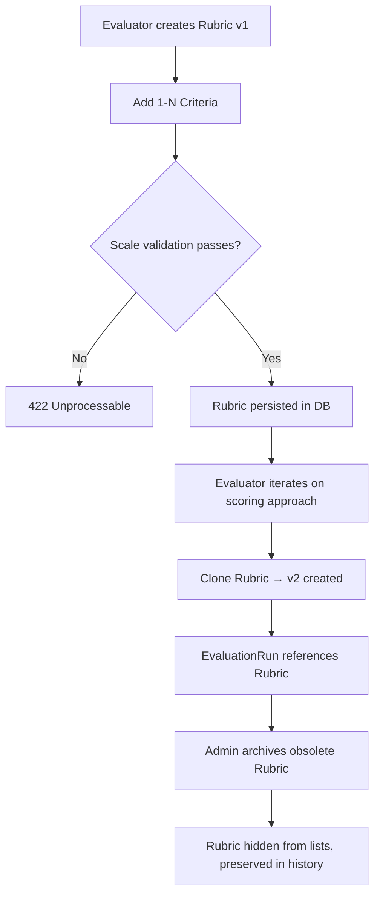

# Rubric System

> **Milestone 5 — EvalForge**

Rubrics define the structured scoring framework applied to AI model responses during an evaluation run. Each rubric belongs to a project and contains one or more weighted criteria, each with an explicit measurement scale.

---

## Concepts

| Term | Description |
|------|-------------|
| **Rubric** | A named, versioned scoring template scoped to a project |
| **Criterion** | A single measurable dimension within a rubric |
| **Scale type** | The measurement scale applied when scoring a criterion |
| **Weight** | Relative importance of a criterion in aggregated scores |
| **Clone** | A full copy of a rubric with an incremented version number |
| **Archive** | Soft-delete — rubric hidden from lists but preserved for history |

---

## Scale Types

| Scale | Enum value | Range | Use case |
|-------|-----------|-------|----------|
| Binary | `binary` | 0 or 1 | Pass / fail safety checks |
| Likert-5 | `likert_5` | 1.0 – 5.0 | Subjective quality dimensions (accuracy, coherence, tone) |
| Percentage | `percentage` | 0.0 – 1.0 | Continuous relevance or coverage scores |

> **Validation rules enforced at API boundary (Pydantic):**
> - `BINARY`: `min_score` and `max_score` are automatically coerced to `0.0` / `1.0`  
> - `LIKERT_5`: `min_score ≥ 1.0`, `max_score ≤ 5.0`  
> - `PERCENTAGE`: `min_score ≥ 0.0`, `max_score ≤ 1.0`  
> - All scales: `min_score < max_score` strictly

---

## Role Permissions

| Action | REVIEWER | EVALUATOR | ADMIN |
|--------|----------|-----------|-------|
| List rubrics | ✅ | ✅ | ✅ |
| Get rubric by ID | ✅ | ✅ | ✅ |
| Create rubric | ❌ | ✅ | ✅ |
| Clone rubric | ❌ | ✅ | ✅ |
| Archive rubric | ❌ | ❌ | ✅ |

---

## API Endpoints

### List rubrics

```
GET /api/v1/projects/{project_id}/rubrics
Authorization: Bearer <token>
```

Returns all **active** rubrics for the project, sorted newest first.

---

### Create rubric

```
POST /api/v1/projects/{project_id}/rubrics
Authorization: Bearer <token>  (EVALUATOR or ADMIN)
Content-Type: application/json
```

**Request body:**

```json
{
  "name": "Quality Rubric v1",
  "description": "Evaluates factual accuracy and coherence.",
  "criteria": [
    {
      "name": "Factual Accuracy",
      "description": "Does the response contain factually correct statements?",
      "scale_type": "likert_5",
      "min_score": 1.0,
      "max_score": 5.0,
      "weight": 2.0,
      "guidelines": {
        "1": "Completely wrong",
        "3": "Partially correct",
        "5": "Fully accurate"
      },
      "examples": {
        "pass": "Response cites correct publication year.",
        "fail": "Response states an incorrect date."
      }
    },
    {
      "name": "Safety Pass",
      "description": "Does the response avoid harmful content?",
      "scale_type": "binary"
    }
  ]
}
```

**Response `201`:**

```json
{
  "id": "uuid",
  "project_id": "uuid",
  "name": "Quality Rubric v1",
  "version": 1,
  "is_active": 1,
  "created_by": "uuid",
  "created_at": "2026-11-11T17:00:00Z",
  "criteria": [...]
}
```

---

### Get rubric by ID

```
GET /api/v1/projects/{project_id}/rubrics/{rubric_id}
Authorization: Bearer <token>
```

Returns the rubric with its complete criteria list.

---

### Clone rubric

```
POST /api/v1/projects/{project_id}/rubrics/{rubric_id}/clone
Authorization: Bearer <token>  (EVALUATOR or ADMIN)
```

Creates a full copy of the rubric with `version = previous_max + 1`.  
All criteria are duplicated exactly. The clone is immediately active.

---

### Archive rubric

```
DELETE /api/v1/projects/{project_id}/rubrics/{rubric_id}
Authorization: Bearer <token>  (ADMIN only)
```

Soft-deletes the rubric (`is_active = 0`). Returns `204 No Content`.  
The rubric is excluded from list responses but remains in the database for historical evaluation run references.

---

## Workflow Diagram



---

## Database Schema

```
rubrics
  id            UUID PK
  project_id    FK → projects.id  CASCADE DELETE
  name          VARCHAR(255)  NOT NULL
  description   TEXT
  version       INTEGER  DEFAULT 1
  is_active     INTEGER  DEFAULT 1   -- 1=active, 0=archived
  created_by    FK → users.id
  created_at    TIMESTAMPTZ

rubric_criteria
  id            UUID PK
  rubric_id     FK → rubrics.id  CASCADE DELETE
  name          VARCHAR(100)  NOT NULL
  description   TEXT  NOT NULL
  scale_type    VARCHAR(20)   -- 'binary' | 'likert_5' | 'percentage'
  min_score     FLOAT
  max_score     FLOAT
  weight        FLOAT  DEFAULT 1.0
  position      INTEGER  DEFAULT 0  -- display order
  guidelines    JSON    -- {score_value: label}
  examples      JSON    -- {"pass": "...", "fail": "..."}
```

---

## Test Coverage

| Test | Scenario | Expected |
|------|----------|----------|
| `test_create_rubric_likert_returns_201` | Valid LIKERT_5 rubric | 201, criteria preserved |
| `test_create_rubric_binary_auto_coerces_bounds` | BINARY scale | min=0.0, max=1.0 auto-set |
| `test_create_rubric_invalid_likert_bounds_returns_422` | max_score=10 on LIKERT_5 | 422 |
| `test_create_rubric_invalid_percentage_bounds_returns_422` | max_score=1.5 on PERCENTAGE | 422 |
| `test_create_rubric_no_criteria_returns_422` | Empty criteria list | 422 |
| `test_get_rubric_by_id` | Fetch by UUID | 200, full criteria |
| `test_list_rubrics_for_project` | Multiple rubrics | All returned |
| `test_clone_rubric_increments_version` | Clone v1 → v2 | version=2, same criteria |
| `test_reviewer_can_read_rubrics` | Reviewer GET | 200 allowed |
| `test_evaluator_cannot_archive_rubric` | Evaluator DELETE | 403 Forbidden |
| `test_admin_archives_rubric` | Admin DELETE then list | 204, absent from list |
