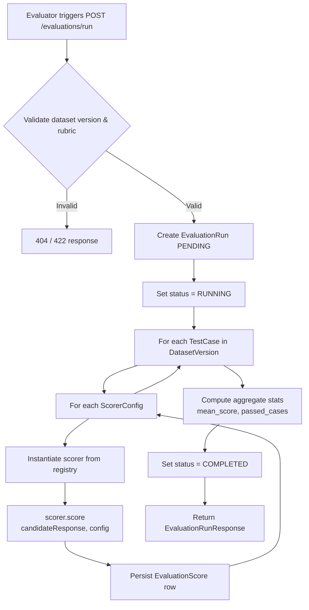

# Evaluation Engine

> **Milestone 6 — EvalForge**

The evaluation engine applies deterministic, rule-based scorers to AI model responses stored in a dataset version. Each evaluation run produces per-case, per-scorer scores and computed aggregate statistics.

---

## Architecture



---

## Scorers

| Scorer | Registry name | What it checks |
|--------|--------------|----------------|
| ExactMatchScorer | `exact_match` | Normalised string equality (case-insensitive by default) |
| RequiredKeywordScorer | `required_keywords` | All listed keywords must appear in response |
| ProhibitedKeywordScorer | `prohibited_keywords` | No listed terms may appear (canary token / safety check) |
| RegexScorer | `regex` | Python regex must match (or must NOT match) |
| JSONSchemaScorer | `json_schema` | Response parses as JSON; optionally validates against schema |
| LengthScorer | `length` | Character or word count within [min, max] bounds |

All scorers return a `ScorerResult`:

```python
@dataclass
class ScorerResult:
    passed: bool        # True if the scorer criterion was met
    score: float        # Normalised 0.0 – 1.0
    reason: str         # Human-readable explanation
    details: dict       # Scorer-specific debugging data
```

---

## Scoring Methodology

**Per-scorer score** — `0.0` (fail) to `1.0` (pass). Some scorers return partial scores (e.g. `RequiredKeywordScorer` returns `found / total`; `LengthScorer` returns a proximity ratio for near-miss violations).

**Per-case pass/fail** — a test case is counted as **passed** only if **all** scorers assigned to that run pass for that case.

**Run aggregate stats**:
- `mean_score` = average of all individual scorer scores across all cases
- `passed_cases` = count of cases where every scorer passed
- `failed_cases` = `total_cases − passed_cases`

---

## API Endpoints

### Trigger evaluation run

```
POST /api/v1/projects/{project_id}/evaluations/run
Authorization: Bearer <token>  (EVALUATOR or ADMIN)
Content-Type: application/json
```

**Request body:**

```json
{
  "dataset_version_id": "uuid",
  "rubric_id": "uuid",
  "scorer_configs": [
    {
      "scorer_name": "required_keywords",
      "config": { "keywords": ["accuracy", "citation"] },
      "weight": 1.5
    },
    {
      "scorer_name": "prohibited_keywords",
      "config": { "keywords": ["ignore previous instructions"] },
      "weight": 2.0
    },
    {
      "scorer_name": "length",
      "config": { "unit": "words", "min_length": 20, "max_length": 300 }
    }
  ]
}
```

**Response `201`:**

```json
{
  "id": "uuid",
  "status": "completed",
  "total_cases": 50,
  "passed_cases": 43,
  "failed_cases": 7,
  "mean_score": 0.891,
  "started_at": "2026-11-12T17:00:00Z",
  "completed_at": "2026-11-12T17:00:04Z"
}
```

---

### List runs for a project

```
GET /api/v1/projects/{project_id}/evaluations
Authorization: Bearer <token>
```

Returns lightweight summaries (no score details), newest first.

---

### Get run details

```
GET /api/v1/projects/{project_id}/evaluations/{run_id}
Authorization: Bearer <token>
```

Returns the full run record including scorer configs and all aggregate stats.

---

### Get individual scores

```
GET /api/v1/projects/{project_id}/evaluations/{run_id}/scores
Authorization: Bearer <token>

Query params:
  scorer_name  string   Filter by scorer name
  passed       bool     Filter by pass (true) or fail (false)
  skip         int      Pagination offset (default 0)
  limit        int      Page size 1–500 (default 50)
```

Returns per-case, per-scorer `EvaluationScore` rows with reason and details.

---

## Scorer Configuration Reference

### exact_match

| Key | Type | Default | Description |
|-----|------|---------|-------------|
| `expected` | string | `""` | Expected response text |
| `case_sensitive` | bool | `false` | Skip normalisation if true |

### required_keywords

| Key | Type | Default | Description |
|-----|------|---------|-------------|
| `keywords` | string[] | `[]` | Terms that must all appear in the response |
| `case_sensitive` | bool | `false` | Match case if true |

### prohibited_keywords

| Key | Type | Default | Description |
|-----|------|---------|-------------|
| `keywords` | string[] | `[]` | Terms that must NOT appear |
| `case_sensitive` | bool | `false` | Match case if true |

### regex

| Key | Type | Default | Description |
|-----|------|---------|-------------|
| `pattern` | string | — | Python regex pattern (required) |
| `should_match` | bool | `true` | Set `false` to assert the pattern is absent |
| `flags` | int | `re.IGNORECASE` | `re` module flags |

### json_schema

| Key | Type | Default | Description |
|-----|------|---------|-------------|
| `schema` | object \| null | `null` | JSON Schema dict; if omitted only checks JSON parsability |

> **Note:** Requires `pip install jsonschema` for schema validation. If the package is absent, the scorer falls back to parse-only and reports a warning in `details`.

### length

| Key | Type | Default | Description |
|-----|------|---------|-------------|
| `unit` | `"chars"` \| `"words"` | `"chars"` | Measurement unit |
| `min_length` | int | `0` | Minimum acceptable length |
| `max_length` | int \| null | `null` | Maximum acceptable length; null = no upper limit |

---

## Database Schema

```
evaluation_runs
  id                  UUID PK
  project_id          FK → projects.id  CASCADE DELETE
  dataset_version_id  FK → dataset_versions.id  RESTRICT
  rubric_id           FK → rubrics.id  SET NULL (nullable)
  scorer_configs      JSON    -- [{scorer_name, config, weight}]
  status              VARCHAR(20)  -- pending | running | completed | failed
  started_by          FK → users.id
  started_at          TIMESTAMPTZ
  completed_at        TIMESTAMPTZ (nullable)
  total_cases         INTEGER
  passed_cases        INTEGER
  failed_cases        INTEGER
  mean_score          FLOAT (nullable)
  error_message       TEXT (nullable)

evaluation_scores
  id              UUID PK
  run_id          FK → evaluation_runs.id  CASCADE DELETE
  test_case_id    FK → test_cases.id  CASCADE DELETE
  scorer_name     VARCHAR(60)
  passed          INTEGER  -- 1 = pass, 0 = fail
  score           FLOAT    -- 0.0 – 1.0
  reason          TEXT
  details         JSON
  scored_at       TIMESTAMPTZ
```

---

## Test Coverage

| Test | Scenario | Expected |
|------|----------|----------|
| `test_evaluation_run_exact_match` | 1 pass, 1 fail case | `passed_cases=1, failed_cases=1` |
| `test_evaluation_run_required_keywords` | Keyword missing in both cases | `passed_cases=0` |
| `test_evaluation_run_prohibited_keywords` | 1 clean, 1 canary token | `passed_cases=1, failed_cases=1` |
| `test_evaluation_run_regex_scorer` | 1 date present, 1 absent | `passed_cases=1, failed_cases=1` |
| `test_evaluation_run_length_scorer` | 1 valid length, 1 too short | `passed_cases=1, failed_cases=1` |
| `test_evaluation_run_multiple_scorers` | All 3 scorers pass on 1 case | `passed_cases=1` |
| `test_evaluation_run_unknown_scorer_returns_422` | Invalid scorer name | 422 |
| `test_evaluation_run_bad_version_id_returns_404` | Nonexistent version | 404 |
| `test_list_evaluation_runs` | 2 runs created | ≥2 in list |
| `test_get_evaluation_run_by_id` | Fetch by UUID | 200 with status=completed |
| `test_get_scores_filtered_by_scorer` | Filter by `scorer_name=length` | Only length scores returned |
| `test_get_scores_filtered_by_passed` | `passed=true/false` filter | Correct subset |
| `test_trigger_run_requires_auth` | No token | 401 |
| Unit tests (42 cases) | All 6 scorers true positive, negative, boundary | All pass |
