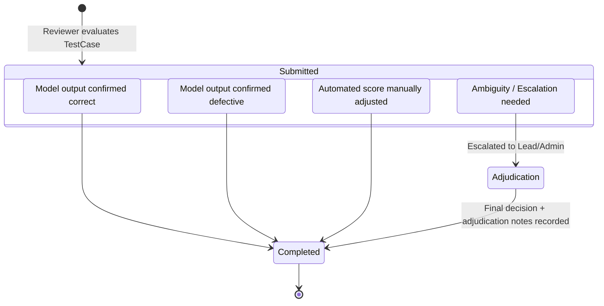
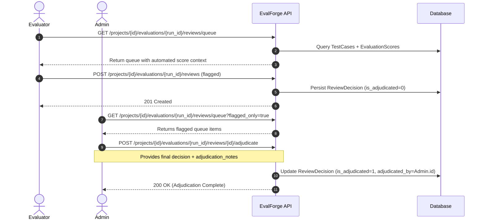

# Human Review & Adjudication Interface

> **Milestone 7 — EvalForge**

EvalForge combines deterministic, automated scoring with qualitative human evaluation and multi-tier adjudication. While automated scorers efficiently flag syntax, pattern, and keyword issues, human review is essential for nuanced instruction following, factual accuracy, safety adherence, and domain-specific tone.

---

## 1. Concepts & Review Roles

| Role | Permissions in Review System |
|---|---|
| **Reader / Reviewer** | Inspect test cases in queue, inspect automated scores, read submitted reviews. Read-only. |
| **Evaluator** | Access review queue, submit human review decisions (`accepted`, `rejected`, `overridden`, `flagged`), update own reviews. |
| **Administrator / Lead** | All evaluator privileges + final adjudication of flagged/disputed decisions, arbitrary review edits, audit logging. |

---

## 2. Review Decision Types



- **`accepted`**: The human evaluator confirms the candidate response is compliant and satisfactory.
- **`rejected`**: The human evaluator confirms the candidate response is defective, incorrect, or unsafe.
- **`overridden`**: The evaluator assigns an explicit numerical `human_score` (e.g. partial credit 0.20 when model refrains from hallucination).
- **`flagged`**: The evaluator flags the case for senior adjudication due to rubric ambiguity or edge-case behavior (`is_adjudicated = 0`).

---

## 3. Human Review Workflow



---

## 4. REST API Reference

### 4.1 Fetch Review Queue

```http
GET /api/v1/projects/{project_id}/evaluations/{run_id}/reviews/queue
Authorization: Bearer <token>
```

**Query Parameters:**
- `unreviewed_only` (bool, default `false`): Cases with 0 human reviews.
- `flagged_only` (bool, default `false`): Cases containing at least one flagged review.
- `disputed_only` (bool, default `false`): Cases where automated scorers failed or reviewers disagreed.
- `skip` / `limit` (int): Pagination parameters.

---

### 4.2 Submit Review Decision

```http
POST /api/v1/projects/{project_id}/evaluations/{run_id}/reviews
Authorization: Bearer <evaluator_or_admin_token>
Content-Type: application/json

{
  "test_case_id": "8a32d184-b5a0-40e8-8b9a-112233445566",
  "criterion_id": null,
  "decision": "overridden",
  "human_score": 0.85,
  "feedback": "Model answered accurately but tone was slightly informal."
}
```

---

### 4.3 Adjudicate Decision

```http
POST /api/v1/projects/{project_id}/evaluations/{run_id}/reviews/{review_id}/adjudicate
Authorization: Bearer <admin_token>
Content-Type: application/json

{
  "decision": "accepted",
  "human_score": 0.90,
  "adjudication_notes": "Reviewed prompt guidelines: informal tone is acceptable for this creative category."
}
```

---

## 5. Database Schema

```
review_decisions
  id                  UUID PK
  project_id          FK -> projects.id (CASCADE)
  run_id              FK -> evaluation_runs.id (CASCADE)
  test_case_id        FK -> test_cases.id (CASCADE)
  reviewer_id         FK -> users.id (RESTRICT)
  criterion_id        FK -> rubric_criteria.id (SET NULL, nullable)
  decision            VARCHAR(30) -- accepted | rejected | flagged | overridden
  human_score         FLOAT (nullable)
  feedback            TEXT NOT NULL
  is_adjudicated      INTEGER (0 = pending, 1 = finalized)
  adjudicated_by      FK -> users.id (SET NULL, nullable)
  adjudication_notes  TEXT (nullable)
  created_at          TIMESTAMPTZ
  updated_at          TIMESTAMPTZ
```

---

## 6. Verification & Test Suite

| Test Identifier | Description | Expected Status |
|---|---|---|
| `test_get_review_queue` | Retrieval of unreviewed cases with automated context | Pass (200) |
| `test_create_review_decisions` | Submission of `accepted` and `overridden` human decisions | Pass (201) |
| `test_review_queue_filters` | Filtering queue by `unreviewed_only` and `flagged_only` | Pass (200) |
| `test_update_review_decision` | Author updating feedback; permissions enforcement | Pass (200) |
| `test_adjudicate_flagged_decision` | Evaluator rejected (403); Admin adjudicates (200) | Pass (200) |
| `test_reviewer_can_list_and_read_reviews` | Read-only reviewer permissions & creation guard | Pass (200/403) |
