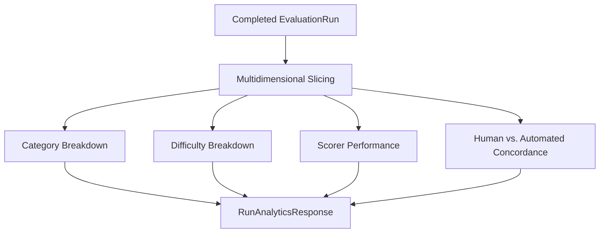
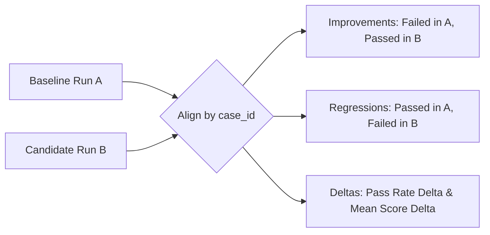

# Analytics, Reporting & Comparative Benchmarking

> **Milestone 8 — EvalForge**

EvalForge provides deep evaluation intelligence through multifaceted analytics aggregation, comparative run benchmarking (A/B testing and regression tracking), project-level summary dashboards, and multi-format data exports.

---

## 1. Analytics & Concordance Architecture



### Metrics Calculated:
- **Pass Rate**: Percentage of cases in slice where all automated scorers passed.
- **Mean Score**: Average normalised score (0.0 – 1.0) across all scorer evaluations in slice.
- **Human Agreement Rate**:
  \[
  \text{Agreement Rate} = \frac{\text{Concordant Cases}}{\text{Total Cases with Human Reviews}} \times 100\%
  \]
  A case is concordant when the automated binary outcome agrees with the human evaluation direction (`accepted`/`overridden` vs. `rejected`) and is not currently flagged.

---

## 2. Comparative Benchmarking (A/B & Regression Analysis)

EvalForge aligns test cases across two evaluation runs by their unique `case_id` to evaluate model or prompt iterations.



---

## 3. REST API Reference

### 3.1 Run Analytics

```http
GET /api/v1/projects/{project_id}/evaluations/{run_id}/analytics
Authorization: Bearer <token>
```

**Response Sample:**

```json
{
  "run_id": "c1f7b492-9382-411a-821f-c9438942b083",
  "project_id": "8931bfa2-32b4-4e92-ba30-109033481022",
  "total_cases": 100,
  "passed_cases": 88,
  "failed_cases": 12,
  "pass_rate": 88.0,
  "mean_score": 0.912,
  "by_category": [
    {
      "category": "Math",
      "total": 40,
      "passed": 38,
      "failed": 2,
      "pass_rate": 95.0,
      "mean_score": 0.965
    }
  ],
  "by_difficulty": [...],
  "by_scorer": [...],
  "human_agreement": {
    "total_reviewed": 25,
    "concordant_cases": 23,
    "discrepancy_count": 1,
    "flagged_count": 1,
    "agreement_rate": 92.0
  }
}
```

---

### 3.2 Comparative Run Benchmarking

```http
GET /api/v1/projects/{project_id}/evaluations/compare?base_run_id={id}&target_run_id={id}
Authorization: Bearer <token>
```

**Response Sample:**

```json
{
  "base_run_id": "...",
  "target_run_id": "...",
  "shared_cases_count": 50,
  "base_pass_rate": 80.0,
  "target_pass_rate": 88.0,
  "pass_rate_delta": 8.0,
  "improvements_count": 5,
  "regressions_count": 1,
  "improvements": [...],
  "regressions": [...]
}
```

---

### 3.3 Data Exports

- **CSV Export**: `GET /api/v1/projects/{project_id}/evaluations/{run_id}/export/csv`
  - Returns a streaming `text/csv` file containing per-case prompts, expected behaviors, model responses, automated scores, and human review decisions.
- **JSON Export**: `GET /api/v1/projects/{project_id}/evaluations/{run_id}/export/json`
  - Returns complete structured run telemetry, test cases, and nested score and review histories.

---

### 3.4 Project Dashboard

```http
GET /api/v1/projects/{project_id}/dashboard
Authorization: Bearer <token>
```

Provides global counts of datasets, versions, historical evaluation runs, overall cumulative pass rate, and recent execution feed.
